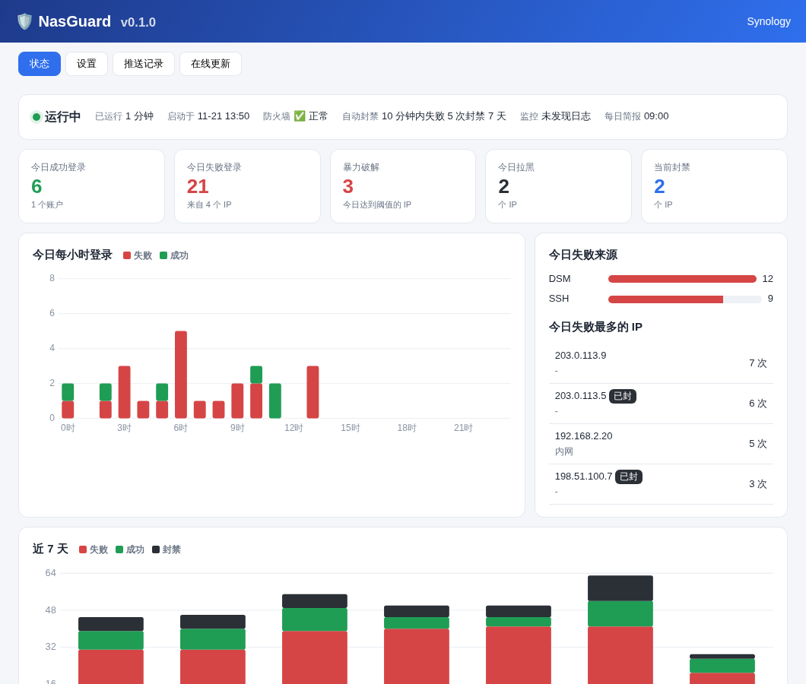
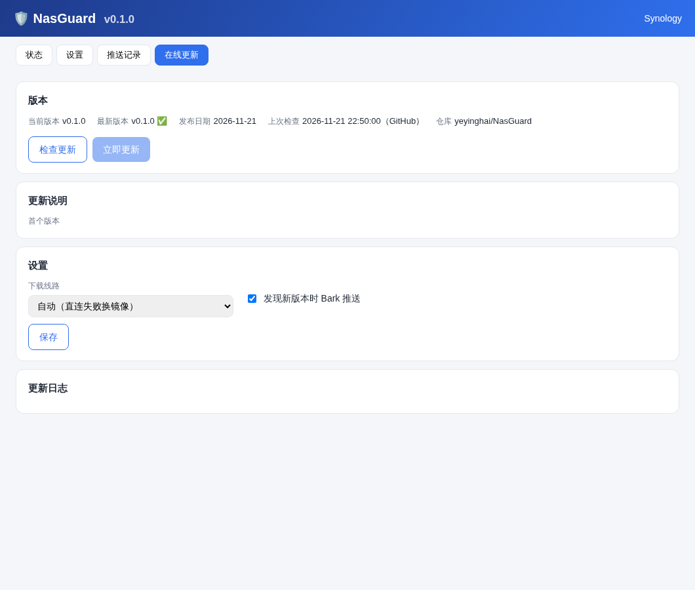

# NasGuard

群晖 DSM 7 登录看门狗：实时监控 **SSH** 和 **DSM 网页** 登录，暴力破解的 IP 自动拉黑，
登录成功、攻击预警和每日安全简报通过 [Bark](https://github.com/Finb/Bark) 推送到 iPhone，推送带 IP 归属地。

作为 DSM 桌面应用在系统窗口里直接打开（和 RR Manager 一样），沿用当前 DSM 管理员登录，不另开网页、不占用任何网络端口。

路由器版见 [openwrt-safedog](https://github.com/yeyinghai/openwrt-safedog)。



## 功能

- **暴力破解预警**：同一 IP 在 N 分钟内失败达到阈值就推送，SSH 和 DSM 网页的失败都计数；同一 IP 可设告警冷却，避免刷屏
- **登录成功提醒**：SSH、DSM 网页登录成功分别可开关，内网登录可选择不提醒
- **自动封禁**：达到阈值的 IP 由 iptables `NASGUARD` 链丢弃（同时挂在 INPUT 与 DOCKER-USER 上，Docker 端口也拦）；封禁时长可设，0 为永久；支持白名单、手动封禁 / 解封，重启自动恢复
- **状态页**：运行状态、今日成功 / 失败登录、暴力破解 IP、今日拉黑、当前封禁；今日每小时和近 7 天图表；失败来源（SSH / DSM）和失败最多的 IP
- **每日安全简报**：定时推送过去 24 小时的失败次数、攻击最多的 IP、最近登录、封禁数和系统资源，可一键立即发送
- **在线更新**：检查本仓库 Release，GitHub 连不上时换用 jsDelivr、ghfast.top、gh-proxy.com；看完更新说明再一键升级，设置和封禁数据保留；有新版本推送提醒（每个版本一次）
- **自建 Bark 本机直连**：Bark 服务就在这台 NAS 上时自动走 127.0.0.1



## 安装

1. 到 [Releases](https://github.com/yeyinghai/NasGuard/releases) 下载 `NasGuard-x.y.z-0001.spk`
2. 套件中心 → 设置 → 信任层级选「任何发行者」
3. 套件中心 → 手动安装 → 选 spk 文件
4. 主菜单打开 **NasGuard**，在「设置」里填 Bark 地址，点「测试推送」

要求 DSM 7.0 及以上（自带 python3）。需要管理员账户才能打开。

## 工作原理

| 部分 | 说明 |
| --- | --- |
| `NasGuard/src/app/guard.py` | 守护进程：读 `/var/log/auth.log`（SSH）与 DSM 连接日志，统计、封禁、推送、简报、在线更新 |
| `NasGuard/src/bin/nasguard-helper` | setuid 小助手（源码 `helper/helper.c`），让守护进程以 root 运行以便操作 iptables |
| `NasGuard/src/ui/` | DSM 应用窗口（`NasGuard.js`）和界面（`index.html`），经 `index.cgi` 通过本地 Unix 套接字与守护进程通信，并用 DSM 自带的 `authenticate.cgi` 校验管理员登录 |

运行日志：`/var/packages/NasGuard/var/nasguard.log`

## 打包与发版

```sh
./build.sh            # 生成 dist/NasGuard-<版本>-0001.spk 和 version.json
```

版本号取自 `CHANGELOG.md` 最新一节，需与 `guard.py` 里的 `VERSION` 一致。推送 `v*` 标签后 GitHub Actions 自动打包并发布 Release。
